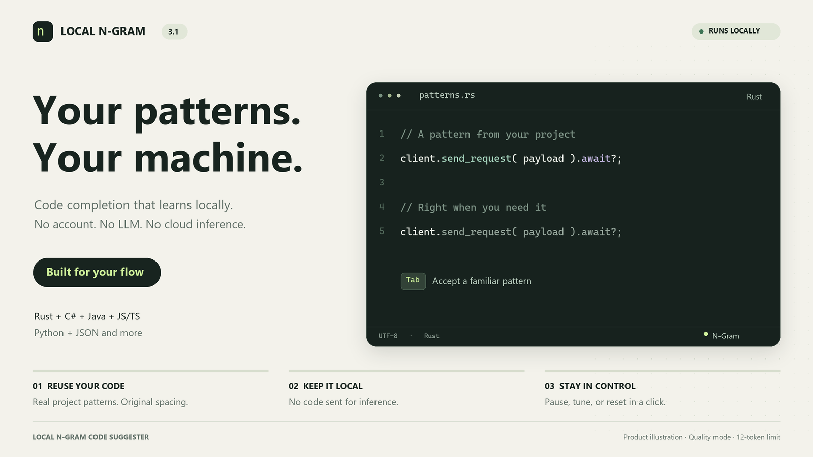
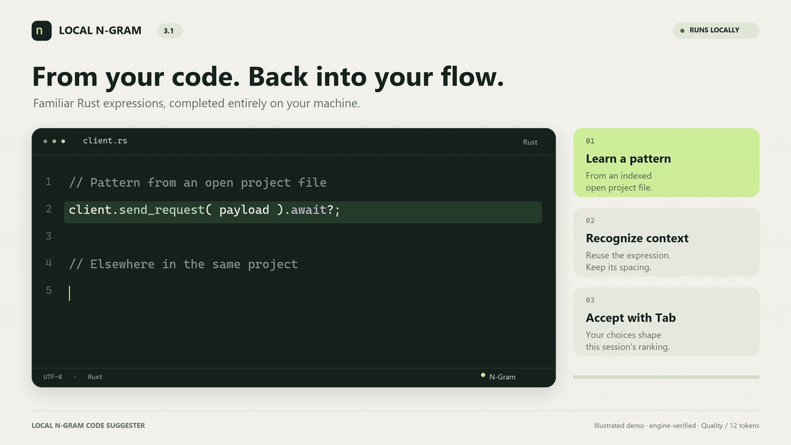

# Local N-Gram Code Suggester

[](https://github.com/kevinski119/local-ngram-code-suggester/actions/workflows/ci.yml)



Fast, private code completion that runs entirely on your machine. Extension v3 uses
comment-aware language profiles, variable-order n-grams, exact backoff, local
project adaptation, and bounded multi-token completion—without an account,
subscription, telemetry, LLM, or mandatory network connection.

## New in v3.1

- **Reuse actual code:** inline suggestions can retrieve matching single-line
  sequences from indexed open files, preserving internal spacing instead of
  assembling every token independently. Matching is exact, stays in the same
  workspace folder/language, and excludes literals and cross-comment/line gaps.
  Existing token limits still apply. Open-file snapshots refresh on save, or
  while editing if `updateOnFileChange` is enabled.
- **Learn your choices:** accepting an inline or IntelliSense suggestion promotes
  that choice when the same context recurs. Preferences are bounded, session-only,
  and never persisted or transmitted. Reset them from the N-Gram menu or disable
  `learnFromAcceptedSuggestions` to erase and stop learning preferences.
- **Do less repeated work:** ghost text and IntelliSense share cached prefix scans.
  Edits, language changes, cursor movement and closed documents invalidate entries.
  Profile preparation is cached rather than repeated at every character.
- **Honor the length setting:** Quality mode now permits up to twelve tokens when
  configured, fixing the hidden five-token cap. The default remains five.

For example, after indexing `client.send_request( payload ).await?;`, typing
`client.` can reuse `send_request( payload ).await?;` when the token limit allows
it. This is local pattern reuse, not type-aware reasoning.

Scanner measurements and methodology are recorded in
[v3.1-runtime.json](benchmarks/v3.1-runtime.json). They are synthetic microbenchmarks,
not end-to-end editor latency or general completion-quality measurements.

## New in extension v3.0

- Rust completion ships offline: `.rs` activation, a bundled starter model,
  trainer support, and shared tokenizer fixtures for nested comments, raw/byte/C
  strings, character literals, lifetimes, raw identifiers, macros, paths and ranges.
- Exact project contexts distinguish receivers such as `screen.height()` and
  `player.health()`. Partial identifiers come from open project files as well as
  the bundled vocabulary. Multi-token continuations can use project patterns.
- Project context is isolated by workspace folder; standalone documents are
  isolated individually. Learning is bounded to 128 documents and 50,000 tokens,
  with a 100,000-character limit per document. Oldest indexed files are evicted.
- Explicit completion edit ranges preserve typed prefixes and matching text after
  the cursor, including existing closing brackets. Conflicting word suffixes are
  suppressed. Code suggestions are suppressed inside unfinished strings.
- Click **N-Gram** in the status bar for pause/resume, settings, diagnostics,
  relearning, clearing project context, and language packs.

This is a local v3 preview. The bundled **model format remains v3** and legacy
v2 models still load. Project context learns from open files, not a disk-wide
workspace crawl. Completion scanning stops after 100,000 characters before the
cursor to bound synchronous work. Rust is lexical pattern completion, not type
inference; use it alongside rust-analyzer.

> This is an attributed MIT-licensed fork of Erik Klabukov's
> [amest/vscode-ngram-code-suggester](https://github.com/amest/vscode-ngram-code-suggester).
> The original extension remains available on the
> [Visual Studio Marketplace](https://marketplace.visualstudio.com/items?itemName=nb47.vscode-ngram-suggester).

## Existing features retained from v2

- Stateful comment/string handling for C#, Java, JavaScript/TypeScript, JSON,
  JSONC, Python, JSX/TSX, Vue, and Razor.
- Comments excluded from training and project context; suggestions in comments
  disabled by default.
- N-gram orders 2–6 with normalized contexts and exact interpolated backoff.
- Fast, Balanced, and Quality performance presets.
- Multi-token inline suggestions with a configurable latency budget.
- Frequency control and a five-token default cap to keep ghost text focused.
- Saved, error-free patterns can transfer across projects at low weight only
  after independent project support; project identities are stored as hashes.
- External-library identifiers are kept in dependency-specific namespaces, so
  a project without `pygame` (or the matching npm/Java/.NET dependency) will
  not receive that library's learned functions.
- Receiver-aware member completion preserves useful API patterns such as
  `screen.get_height() / 2` while numeric literals remain structural context.
- Local model, cache, project, and p95 latency diagnostics.
- Optional user-initiated language packs with size and SHA-256 verification.
- Backward-compatible loading of v2 JSON and JSON.gz models.

## Build and test

Requirements: Python 3.9+, Node.js 22+, and VS Code 1.85+.

CI runs compilation, lint, runtime and trainer tests, Extension Host integration,
benchmarks, and clean-profile VSIX installation on Windows, Ubuntu and macOS.
The Actions run publishes a separate installer artifact for each runner platform.

## Illustrated Rust demo



This is an illustrated demo using verified output from the v3.1 project engine,
not a screen recording or latency benchmark. It uses Quality mode with a
12-token limit; the default is five. [MP4 version](extension/assets/marketplace/rust-demo-v31.mp4).

## Build commands

```bash
cd extension
npm ci
npm test
npm run package

cd ..
python -m unittest discover -s tests -v
python benchmarks/run_benchmark.py
```

Install the resulting VSIX:

```bash
code --install-extension extension/local-ngram-code-suggester-3.1.0.vsix
```

## Train a model v3

The dependency-free trainer excludes common generated/vendor directories and
uses the same language profiles as the extension.

```bash
python code_model_trainer.py \
  --model extension/models/model.json \
  --language all \
  --n-gram 6 \
  --include-starter-corpus \
  --fresh
```

Use `--language cs|java|js|json|ts|py|rust|all`, or supply one or more source globs
with `--pattern`. The optional starter corpus is original MIT-licensed,
deterministically generated training data for stronger cold-start structure.
Without `--fresh`, training merges into a compatible existing model. Public
packs must document corpus sources and redistribution licenses.

To rebuild only the Rust portion of the bundled model while retaining the other
languages, run `python extend_rust_model.py extension/models/model.json.gz`.
This command replaces existing Rust counts and is safe to repeat.

## Settings

| Setting | Default | Purpose |
| --- | ---: | --- |
| `codeSuggester.enabled` | `true` | Pause/resume all suggestions |
| `codeSuggester.reuseProjectSequences` | `true` | Prefer matching source sequences for inline completion |
| `codeSuggester.learnFromAcceptedSuggestions` | `true` | Remember accepted choices only for this session |
| `codeSuggester.performancePreset` | `quality` | Fast, Balanced, or Quality behavior |
| `codeSuggester.maxLatencyMs` | `35` | Inline completion computation budget |
| `codeSuggester.minConfidence` | `0.85` | Hide weak cold-start predictions |
| `codeSuggester.enableMultiToken` | `true` | Bounded multi-token inline completion |
| `codeSuggester.maxInlineTokens` | `5` | Maximum length of one ghost-text suggestion |
| `codeSuggester.suggestionFrequency` | `50` | Automatic suggestion frequency from 0 to 100 |
| `codeSuggester.suggestInComments` | `false` | Permit code suggestions in comments |
| `codeSuggester.modelPath` | bundled model | Custom model path |
| `codeSuggester.useProjectContext` | `true` | Learn from open supported documents |
| `codeSuggester.updateOnFileChange` | `false` | Re-index documents while editing |
| `codeSuggester.crossProjectLearning` | `true` | Conservatively retain portable saved patterns |
| `codeSuggester.languagePacks.autoUpdate` | `false` | Opt into pack update checks |
| `codeSuggester.languagePacks.catalogUrl` | empty | Trusted optional pack catalog |

## Marketplace release status

The v3 preview is packaged locally for review, not published. Run
`npm run release:check` from `extension/` to rebuild and validate the upload
artifact. Publishing remains a separate release step under `KevinJarz`.

The Marketplace preview images and feature animation are deterministic,
privacy-safe Pillow renders driven by the bundled n-gram model. Optional
language-pack catalog URLs and corpus/license records are required only when
public packs are published; they do not block the bundled starter release.

Development and issue tracking live at
[kevinski119/local-ngram-code-suggester](https://github.com/kevinski119/local-ngram-code-suggester).

See [ROADMAP.md](ROADMAP.md), [SUPPORT.md](SUPPORT.md),
[SECURITY.md](SECURITY.md), [CONTRIBUTING.md](CONTRIBUTING.md), and
[PUBLISHING.md](PUBLISHING.md).

## Reproducible offline benchmark

The checked-in smoke corpus is intentionally small, but it prevents silent
accuracy and latency regressions. Missing predictions count as zero.

| Engine | Coverage | Top-1 | Top-3 | MRR | Lookup p95 |
| --- | ---: | ---: | ---: | ---: | ---: |
| v1.2 fixed-order baseline | 8.6% | 4.3% | 5.4% | 0.048 | 0.006 ms |
| v2.1 Quality (`0.85` gate) | 74.6% | 55.1% | 57.4% | 0.563 | 0.087 ms |

Results: [v1.2 baseline](benchmarks/v1.2-baseline.json) and
[current v2](benchmarks/latest.json). Public quality claims must additionally
use held-out repositories supplied through repeated `--test-root` arguments.

The v3 core smoke result is in [v3-core.json](benchmarks/v3-core.json); it retains
the v2 baseline accuracy. The separate original Rust smoke fixture is evaluated
with `python benchmarks/run_benchmark.py --test-root benchmarks/rust-fixtures
--min-confidence 0.85`. These measure global next-token lookup only, not project
adaptation or end-to-end editor latency. They are not broad quality estimates.

## License and attribution

MIT. The original copyright notice remains unchanged in [LICENSE](LICENSE).
