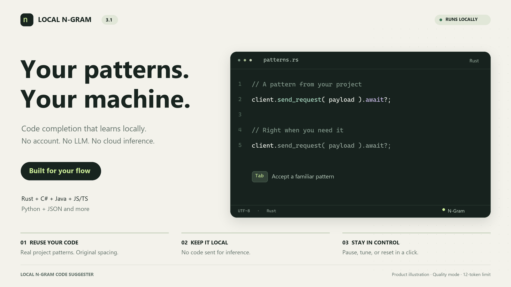
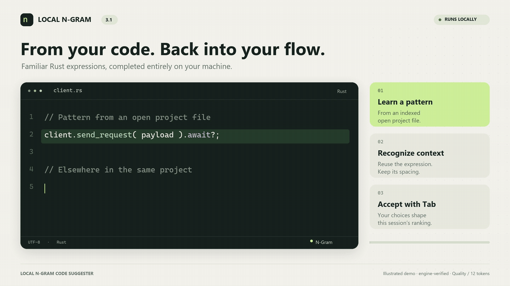
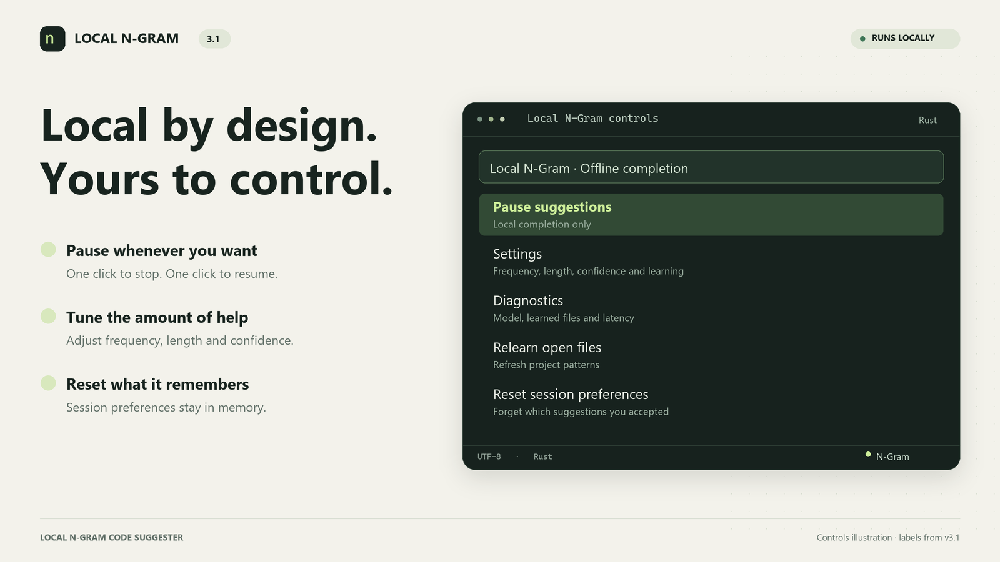

# Local N-Gram Code Suggester

Fast, private completion for Rust and more. Runs locally with no LLM or account.

## Highlights

- Reuse matching single-line code sequences from indexed open files, preserving
  spacing. Strings and comments are excluded, and configured token caps apply.
- Accepted suggestions personalize ranking for the same context during this
  session. Preferences stay in memory and can be reset or disabled.
- Share cached scans between completion providers and prepare tokenization rules
  once for faster repeated requests. Quality mode now honors lengths up to twelve
  tokens when configured; the default remains five.
- Rust support with a bundled starter model: nested comments, raw strings,
  lifetimes, macros and paths share tokenizer coverage with the Python trainer.
- Learn exact patterns and identifier prefixes from open files in the same
  workspace folder, including project-aware multi-token continuation.
- Preserve typed prefixes and matching text after the cursor when accepting.
- Click **N-Gram** in the status bar to pause/resume or open the controls menu.
- Inline and IntelliSense completion without an account or subscription.
- Comments are excluded from code context and training.
- Variable-order n-grams with exact backoff instead of model-wide fuzzy scans.
- Bounded multi-token suggestions with Fast, Balanced, and Quality presets.
- Focused automatic frequency control and shorter five-token suggestions.
- Conservative cross-project learning from saved, error-free files. A pattern
  needs support from multiple projects and never outweighs the bundled model.
- Receiver-aware API member patterns and useful numeric expressions.
- Optional local project adaptation and free language-pack support.
- Local diagnostics with no telemetry.

Supported profiles: Rust, C#, Java, JavaScript, TypeScript, JSON/JSONC, Python,
JSX/TSX, Vue, and Razor.

Project learning uses open files, up to 128 files and 50,000 tokens. Files over
100,000 characters are skipped; completion is skipped past that cursor offset.
Rust suggestions are based on lexical patterns and complement rust-analyzer.
This v3 preview keeps model format v3 and compatibility with legacy v2 models.
Open-file learning snapshots refresh on save; enable `updateOnFileChange` for
updates while editing. Use `reuseProjectSequences` and
`learnFromAcceptedSuggestions` to control the new v3.1 features.

Source, releases, and issue tracking:
[kevinski119/local-ngram-code-suggester](https://github.com/kevinski119/local-ngram-code-suggester).

## Offline project-pattern demo

The animation is an illustrated editor demo using verified output from the real
v3.1 project-context engine. It is not a screen recording or latency benchmark.
It uses Quality mode with a 12-token limit; the default is five tokens.

Run **Local N-Gram: Show Model Diagnostics** to inspect the active model and
latency. Run **Local N-Gram: Manage Language Packs** to import a local pack or
use a configured trusted catalog. No pack is downloaded without user action.

## Privacy

Tokenization, completion, project context, and diagnostics stay on your
machine. Network access is limited to user-initiated pack catalog/download
operations or explicitly opted-in pack update checks.

Cross-project learning stays in VS Code global storage on this machine. It
stores hashed project identities, caps each project's contribution, ignores
files with reported errors, and requires multiple-project support before a
pattern can be suggested. Learned library identifiers are namespaced by detected
pip, npm, Java, or .NET imports and activate only when the same dependency is
present. Run **Local N-Gram: Clear Cross-Project Learning** at any time to erase
it.

## Attribution

Derived from Erik Klabukov's
[amest/vscode-ngram-code-suggester](https://github.com/amest/vscode-ngram-code-suggester)
under the MIT License. The
[original Marketplace listing](https://marketplace.visualstudio.com/items?itemName=nb47.vscode-ngram-suggester)
is maintained separately.

## License

MIT. See the included license.
