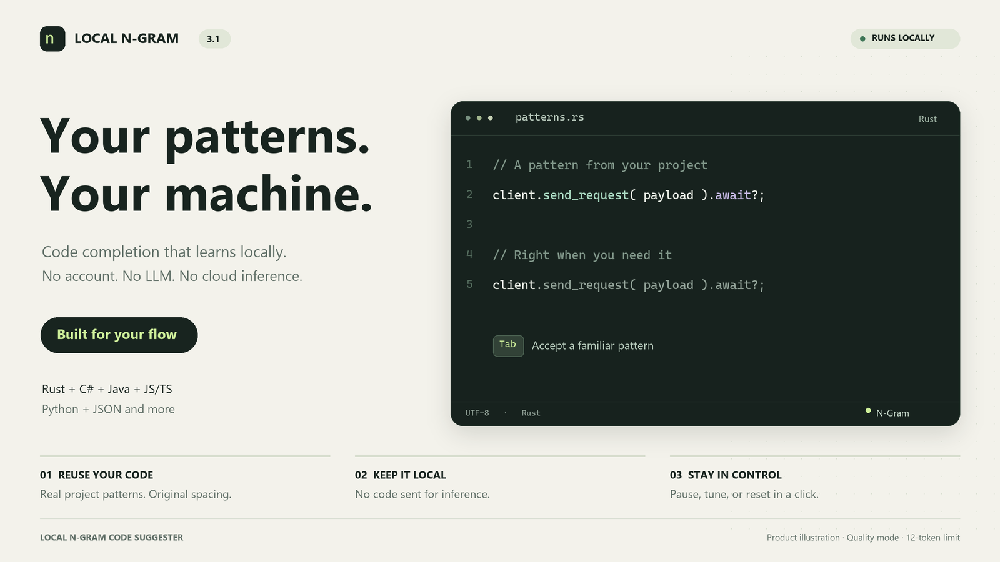
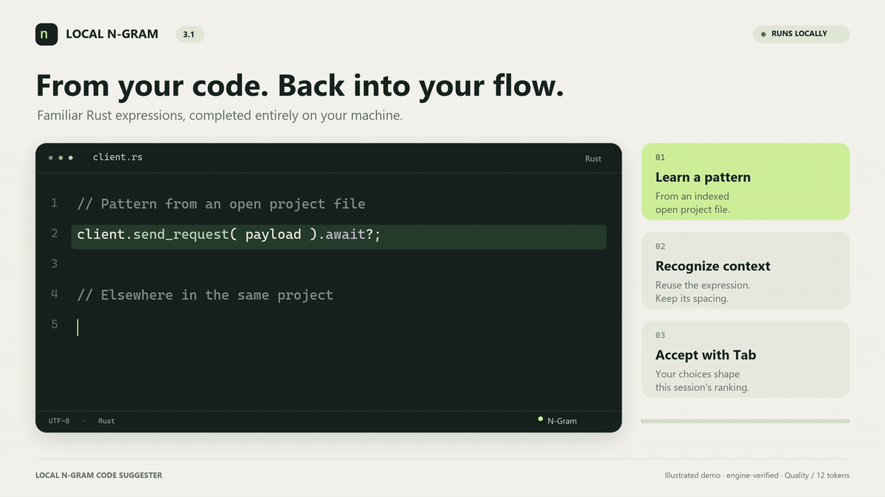

# Marketplace media

## v3.1 illustrated set

The new graphics use an ivory, forest-green and lime palette with readable code.
They are product illustrations, not VS Code screenshots or screen recordings.
The Rust completion is exported from the real project-context engine; its output
and session preference ranking are checked by `scripts/export-demo-data.js`.

- `hero-v31.png` — 1600 × 900 product overview.
- `rust-completion-v31.png` — 1600 × 900 ghost-text explainer.
- `controls-v31.png` — 1600 × 900 controls illustration using actual v3.1 labels.
- `rust-demo-v31.mp4` — 12-second, 1600 × 900 H.264 animation.
- `rust-demo-v31.gif` — looping 1200 × 675 version for Markdown/Marketplace use.
- `demo-data-v31.json` — verified, original public example used by the renderer.





The example uses Quality mode with `maxInlineTokens` set to 12; the default is
still 5. The animation intentionally slows typing and acceptance for readability
and makes no inference-latency claim. It uses no private source or screenshots.

To regenerate from the repository, first compile the extension, then run:

```powershell
node extension/scripts/export-demo-data.js
python extension/scripts/render-v31-media.py --output extension/assets/marketplace
```

The renderer needs Pillow, ffmpeg and the Windows Segoe UI / Cascadia Mono fonts.
Original v2 assets remain available. The repository and Marketplace README source
now reference the v3.1 assets; updating the live Marketplace listing still requires
publishing a new extension package.

## Future real-screen captures

Capture these from a clean Extension Development Host after the publisher and
fork metadata are finalized:

- `completion-demo.gif`: type a supported code example, show comment
  suppression, then accept a short inline completion.
- `diagnostics.png`: open **Show Model Diagnostics** with only public starter
  model data visible.
- `pack-manager.png`: show the pack manager with the final trusted catalog.

Do not fabricate acceptance behavior or include private filenames, source code,
accounts, notifications, or unrelated extensions. Reference the final assets
from `extension/README.md` through public HTTPS URLs.
